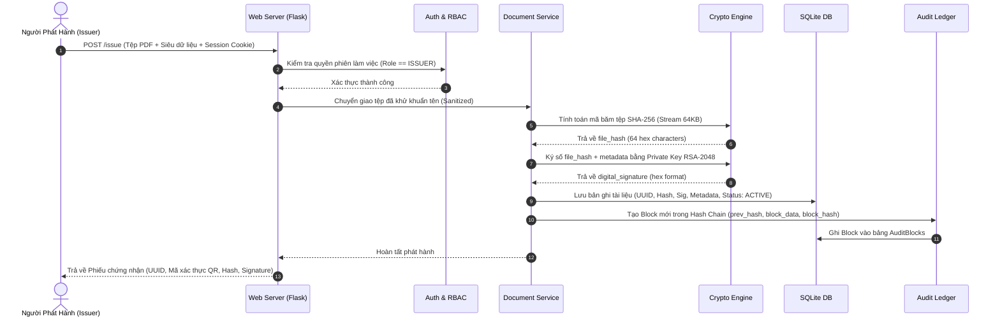
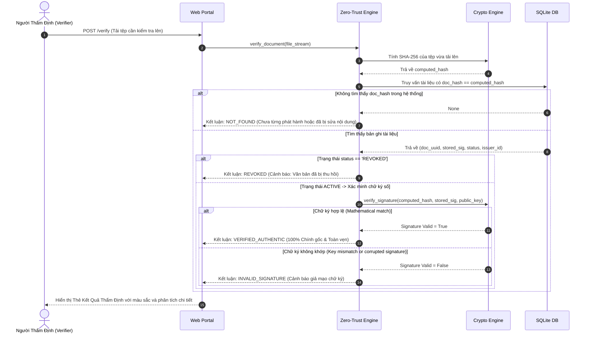

# KIẾN TRÚC HỆ THỐNG VÀ THIẾT KẾ THÀNH PHẦN (SYSTEM ARCHITECTURE)
**Dự án:** SecuDoc - Tamper-Evident Digital Document Verification & Audit System  
**Học phần:** Bảo mật Mạng Máy tính và Hệ thống  

---

## 1. TỔNG QUAN KIẾN TRÚC ĐA TẦNG (LAYERED ARCHITECTURE)

SecuDoc được thiết kế theo mô hình kiến trúc phân tầng rõ ràng (Multi-Layer Modular Architecture), tách bạch giữa giao diện, nghiệp vụ kiểm soát truy cập, động cơ mật mã học và tầng lưu trữ dữ liệu an toàn.

```
┌────────────────────────────────────────────────────────────────────────┐
│                        TẦNG TRÌNH DIỄN (UI / CLIENT)                   │
│   ┌─────────────────────┐  ┌────────────────────┐  ┌────────────────┐  │
│   │  Public Verification│  │  Issuer Dashboard  │  │  Attack Lab    │  │
│   │  Portal (Drag&Drop) │  │  (Issue & Revoke)  │  │  Simulator     │  │
│   └──────────┬──────────┘  └─────────┬──────────┘  └────────┬───────┘  │
└──────────────┼───────────────────────┼──────────────────────┼──────────┘
               │ HTTP / JSON REST API  │                      │
┌──────────────▼───────────────────────▼──────────────────────▼──────────┐
│                   TẦNG CỔNG DỊCH VỤ WEB (FLASK APPLICATION)            │
│   - Route Controllers: Index, Verify, Dashboard, Audit, AttackDemo     │
│   - Security Headers: Content-Security-Policy, X-Frame-Options, HSTS   │
│   - Input Validator & File Size Guard (Max 10MB)                       │
└──────────────────────────────────┬─────────────────────────────────────┘
                                   │
┌──────────────────────────────────▼─────────────────────────────────────┐
│                   TẦNG DỊCH VỤ NGHIỆP VỤ (SERVICES LAYER)              │
│   ┌─────────────────────┐  ┌────────────────────┐  ┌────────────────┐  │
│   │   Auth & RBAC       │  │  Document Service  │  │ Zero-Trust     │  │
│   │   Service (PBKDF2)  │  │  (Issuance/Revoke) │  │ Verify Engine  │  │
│   └──────────┬──────────┘  └─────────┬──────────┘  └────────┬───────┘  │
│              │                       │                      │          │
│              └───────────────────────┼──────────────────────┘          │
│                                      ▼                                 │
│                    ┌───────────────────────────────────┐               │
│                    │     Audit Service (Hash Chain)    │               │
│                    └─────────────────┬─────────────────┘               │
└──────────────────────────────────────┼─────────────────────────────────┘
                                       │
┌──────────────────────────────────────▼─────────────────────────────────┐
│               TẦNG ĐỘNG CƠ MẬT MÃ HỌC (CORE CRYPTO ENGINE)             │
│   ┌─────────────────────┐  ┌────────────────────┐  ┌────────────────┐  │
│   │   Key Management    │  │  Hashing Engine    │  │  Signature     │  │
│   │   (RSA-2048 Vault)  │  │  (Chunked SHA-256) │  │  Engine (PKCS1)│  │
│   └─────────────────────┘  └────────────────────┘  └────────────────┘  │
└──────────────────────────────────────┬─────────────────────────────────┘
                                       │
┌──────────────────────────────────────▼─────────────────────────────────┐
│                     TẦNG LƯU TRỮ VÀ DỮ LIỆU (STORAGE LAYER)            │
│   ┌─────────────────────────────────────┐  ┌────────────────────────┐  │
│   │ SQLite Database (secudoc.db)        │  │ Key Store (data/keys/) │  │
│   │ - Users (PBKDF2 Salted Hashes)      │  │ - root_private.pem     │  │
│   │ - Documents (Hashes, Meta, Sig)     │  │ - root_public.pem      │  │
│   │ - AuditBlocks (Merkle Hash Chain)   │  │                        │  │
│   │ - Revocations (Log & Reason)        │  │ File Vault (data/up..) │  │
│   └─────────────────────────────────────┘  └────────────────────────┘  │
└────────────────────────────────────────────────────────────────────────┘
```

---

## 2. THIẾT KẾ SƠ ĐỒ TUẦN TỰ (SEQUENCE DIAGRAMS)

### 2.1. Luồng Phát Hành Văn Bản Ký Số (Document Issuance Flow)


### 2.2. Luồng Thẩm Định Không Tin Cậy (Zero-Trust Verification Flow)


---

## 3. THIẾT KẾ CƠ SỞ DỮ LIỆU (DATABASE SCHEMA / ERD)

Cơ sở dữ liệu SQLite được chuẩn hóa gồm 4 bảng cốt lõi:

```
┌─────────────────────────────────┐       ┌───────────────────────────────────┐
│              USERS              │       │             DOCUMENTS             │
├─────────────────────────────────┤       ├───────────────────────────────────┤
│ id: INTEGER PRIMARY KEY         │       │ id: INTEGER PRIMARY KEY           │
│ username: TEXT UNIQUE NOT NULL  │◄──┐   │ doc_uuid: TEXT UNIQUE NOT NULL    │
│ password_hash: TEXT NOT NULL    │   └───│ issuer_id: INTEGER NOT NULL       │
│ salt: TEXT NOT NULL             │       │ title: TEXT NOT NULL              │
│ full_name: TEXT NOT NULL        │       │ recipient_name: TEXT NOT NULL     │
│ role: TEXT NOT NULL             │       │ doc_type: TEXT NOT NULL           │
│ created_at: TIMESTAMP           │       │ original_filename: TEXT NOT NULL  │
└─────────────────────────────────┘       │ file_size: INTEGER NOT NULL       │
                                          │ doc_hash: TEXT NOT NULL (INDEXED) │
                                          │ signature: TEXT NOT NULL          │
                                          │ status: TEXT NOT NULL ('ACTIVE'..)│
                                          │ issued_at: TIMESTAMP NOT NULL     │
                                          │ file_storage_path: TEXT NOT NULL  │
                                          └─────────────────┬─────────────────┘
                                                            │
                                  ┌─────────────────────────┴─────────────────┐
                                  ▼                                           ▼
┌─────────────────────────────────────────┐       ┌───────────────────────────┐
│               AUDIT_BLOCKS              │       │        REVOCATIONS        │
├─────────────────────────────────────────┤       ├───────────────────────────┤
│ block_index: INTEGER PRIMARY KEY        │       │ id: INTEGER PRIMARY KEY   │
│ prev_block_hash: TEXT NOT NULL          │       │ doc_uuid: TEXT NOT NULL   │
│ timestamp: TIMESTAMP NOT NULL           │       │ revoked_by: INTEGER       │
│ action: TEXT NOT NULL ('ISSUE','REVOKE')│       │ revocation_reason: TEXT   │
│ doc_uuid: TEXT NOT NULL                 │       │ revoked_at: TIMESTAMP     │
│ payload_hash: TEXT NOT NULL             │       └───────────────────────────┘
│ block_hash: TEXT NOT NULL (INDEXED)     │
└─────────────────────────────────────────┘
```

### Chi tiết Cơ chế Sổ Cái Bất Biến (Audit Hash Chain):
Mỗi block $B_i$ trong bảng `AUDIT_BLOCKS` được tính toán thông qua hàm băm mật mã học:
$$\text{block\_hash}_i = \text{SHA256}\left( \text{block\_index}_i \,||\, \text{prev\_block\_hash}_{i-1} \,||\, \text{timestamp}_i \,||\, \text{action}_i \,||\, \text{doc\_uuid}_i \,||\, \text{payload\_hash}_i \right)$$
- Block nguyên thủy ($B_0$ - Genesis Block) có $\text{prev\_block\_hash} = \text{"0" * 64}$.
- Nếu bất kỳ ai can thiệp sửa đổi dù chỉ 1 ký tự trong cơ sở dữ liệu (ví dụ đổi ngày phát hành hoặc mã tài liệu), khi hàm `verify_audit_chain()` duyệt qua toàn bộ bảng, $\text{block\_hash}_i$ tính toán lại sẽ không khớp với giá trị lưu trữ, và $\text{prev\_block\_hash}_{i+1}$ của block kế tiếp cũng bị vỡ. Hệ thống sẽ ngay lập tức chỉ ra chính xác vị trí bị làm giả.

---

## 4. QUẢN LÝ KHÓA VÀ AN TOÀN LƯU TRỮ (KEY & STORAGE ARCHITECTURE)

1. **Khởi tạo Khóa:** Khi ứng dụng chạy lần đầu, `KeyManager` kiểm tra thư mục `data/keys/`. Nếu chưa có khóa, hệ thống sử dụng thuật toán RSA của thư viện `cryptography` để sinh cặp khóa:
   - Độ dài khóa: 2048 bits.
   - Số mũ công khai: $e = 65537$.
2. **Lưu trữ Khóa Riêng:** Lưu dưới định dạng chuẩn PEM (`PKCS#8`) tại `data/keys/root_private.pem`. Quyền truy cập tệp trên hệ điều hành được giới hạn cho user chạy dịch vụ. Khóa riêng không bao giờ được gửi qua API hay hiển thị trên giao diện người dùng.
3. **Xuất Khóa Công Khai:** Lưu dưới định dạng chuẩn PEM (`SubjectPublicKeyInfo`) tại `data/keys/root_public.pem`. Khóa này được nạp vào bộ thẩm định để kiểm tra chữ ký số của các văn bản.
