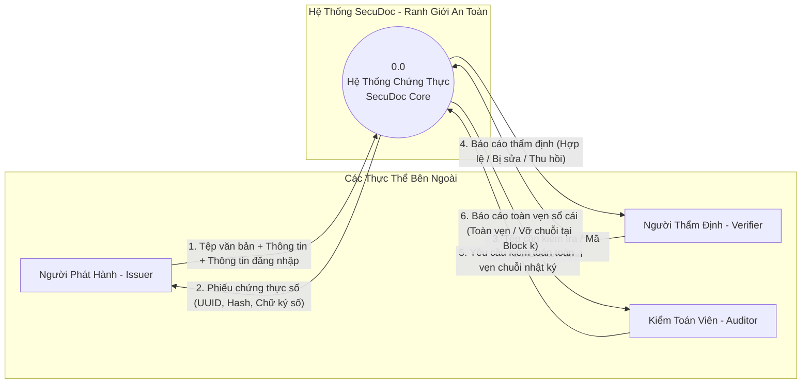

# BIỂU ĐỒ VÀ MÔ HÌNH LUỒNG DỮ LIỆU (DATA FLOW DIAGRAM - DFD)
**Dự án:** SecuDoc - Tamper-Evident Digital Document Verification & Audit System  
**Học phần:** Bảo mật Mạng Máy tính và Hệ thống  

---

## 1. DFD CẤP 0 (CONTEXT DIAGRAM - BIỂU ĐỒ NGỮ CẢNH)

Biểu đồ ngữ cảnh thể hiện ranh giới tương tác giữa hệ thống SecuDoc và các tác nhân bên ngoài:



---

## 2. DFD CẤP 1 (DETAILED DATA FLOW DIAGRAM)

Chi tiết hóa các tiến trình xử lý và kho dữ liệu bên trong hệ thống:

```
[ Issuer ] ──────────────────────┐
                                 │ Tệp văn bản gốc + Metadata
                                 ▼
                 ┌────────────────────────────────┐
                 │ 1.0 Kiểm tra & Khử khuẩn Tệp  │
                 │     (Sanitization & Filter)    │
                 └───────────────┬────────────────┘
                                 │ Stream nhị phân an toàn
                                 ▼
                 ┌────────────────────────────────┐
                 │ 2.0 Tính Toán Mã Băm SHA-256   │◄──── Thuật toán SHA-256
                 └───────────────┬────────────────┘
                                 │ File Hash (64 hex chars)
                                 ▼
                 ┌────────────────────────────────┐
                 │ 3.0 Ký Số Điện Tử RSA-2048     │◄──── [ Kho Khóa: root_private.pem ]
                 └───────────────┬────────────────┘
                                 │ Digital Signature (RSA PKCS#1 v1.5)
                                 ▼
                 ┌────────────────────────────────┐
                 │ 4.0 Lưu Trữ & Tạo Sổ Cái       ├─────► [(D1) Database: DOCUMENTS]
                 │     (Append to Hash-Chain)     ├─────► [(D2) Database: AUDIT_BLOCKS]
                 └───────────────┬────────────────┘       [(D3) Vault: File Storage]
                                 │
                                 ▼
                 [ Trả Phiếu Chứng Nhận Cho Issuer ]

-----------------------------------------------------------------------------------------

[ Verifier ] ────────────────────┐
                                 │ Tệp thẩm tra (Untrusted Input)
                                 ▼
                 ┌────────────────────────────────┐
                 │ 5.0 Trích Xuất & Băm Tệp Mới   │
                 └───────────────┬────────────────┘
                                 │ Computed Hash
                                 ▼
                 ┌────────────────────────────────┐
                 │ 6.0 Đối Soát & Thẩm Định       │◄───── [(D1) Database: DOCUMENTS]
                 │     (Zero-Trust Matcher)       │◄───── [ Kho Khóa: root_public.pem ]
                 └───────────────┬────────────────┘
                                 │
             ┌───────────────────┼───────────────────┐
             │                   │                   │
             ▼                   ▼                   ▼
    [ Hash Không Khớp ]   [ Trạng Thái REVOKED ] [ Hash & Chữ Ký Khớp ]
             │                   │                   │
             ▼                   ▼                   ▼
    Trạng thái TAMPERED    Trạng thái REVOKED   Trạng thái VERIFIED
```

---

## 3. ĐIỂM CHUYỂN TIẾP TRẠNG THÁI TIN CẬY (TRUST TRANSITION BOUNDARIES)

Theo nguyên tắc chủ đạo: *"Không phải mọi thông tin hệ thống nhận được đều đáng tin cậy"*, dữ liệu di chuyển qua các cấp độ tin cậy sau:

| Dữ Liệu Đầu Vào | Trạng Thái Ban Đầu | Điểm Kiểm Tra An Toàn (Checkpoint) | Điều Kiện Chuyển Sang Trạng Thái Tin Cậy | Trạng Thái Sau Xử Lý |
|:---|:---:|:---|:---|:---:|
| **Tệp tải lên phát hành** | `UNTRUSTED` | 1. Dung lượng <= 10MB<br>2. Phần mở rộng được phép (.pdf, .docx, .png)<br>3. Tên tệp được chuẩn hóa khử Path Traversal | Tệp vượt qua bộ lọc an toàn, được gán UUID cô lập | `ACCEPTED_FOR_SIGNING` |
| **Mã băm tệp** | `UNVERIFIED` | Tính toán trực tiếp bằng SHA-256 theo từng chunk 64KB | Khóa riêng RSA ký thành công lên mã băm | `CRYPTOGRAPHICALLY_SEALED` |
| **Tệp tải lên thẩm định** | `UNTRUSTED` | 1. Tính toán lại mã băm độc lập<br>2. Tìm kiếm đối ứng trong DB<br>3. Kiểm tra chữ ký bằng Public Key<br>4. Tra cứu danh sách thu hồi | Mã băm trùng khớp 100% VÀ chữ ký số hợp lệ VÀ trạng thái ACTIVE | `VERIFIED_AUTHENTIC` |
| **Bản ghi Cơ sở dữ liệu** | `POTENTIALLY_TAMPERED` | Kiểm tra tính toán chuỗi băm liên hoàn Merkle / Hash Chain | $H_i = \text{SHA256}(H_{i-1} \,||\, \text{Data}_i)$ khớp với toàn bộ lịch sử | `AUDITED_IMMUTABLE` |

---

## 4. VÒNG ĐỜI DỮ LIỆU (DATA LIFECYCLE)

1. **Khởi tạo (Ingestion):** Người phát hành gửi tệp và siêu dữ liệu -> Hệ thống kiểm tra hợp thức -> Lưu trữ tệp dưới định dạng cô lập `data/uploads/{uuid}.bin`.
2. **Ký số & Gắn kết (Sealing):** Tạo mã băm SHA-256 -> Ký số với khóa RSA-2048 -> Đóng block vào sổ cái băm `AUDIT_BLOCKS`.
3. **Thẩm tra (Verification):** Người dùng thẩm định gửi tệp -> Hệ thống tính lại mã băm -> Xác thực toán học -> Trả về kết luận chẩn đoán không thay đổi trạng thái hệ thống.
4. **Thu hồi (Revocation):** Issuer kích hoạt thu hồi kèm lý do -> Đổi cờ `status = 'REVOKED'` trong bảng `DOCUMENTS` -> Sinh một block mới loại `REVOKE` trong sổ cái `AUDIT_BLOCKS`.
5. **Kiểm toán (Auditing):** Định kỳ hoặc khi có yêu cầu điều tra, Auditor chạy tiến trình xác minh toàn bộ chuỗi khối từ Genesis block đến block mới nhất.
